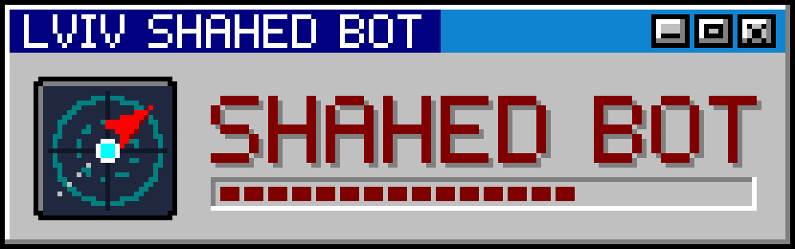

<p align="center">
  
</p>

<p align="center">
  <b>A Telegram air-raid bot: a live map of alerts and incoming targets for the region you track.</b><br>
  Shahed drones, missiles and KABs with course and trail, distance rings, one card that updates itself.
</p>

<p align="center">
  <code>Rust 2024</code> · <code>tokio</code> · <code>tiny-skia</code> · <code>alerts.in.ua</code> · <code>NEPTUN</code> · <code>OpenStreetMap</code>
</p>

> Not an official warning system. Always follow the official air-raid alerts.

---

## What it does

The chat always holds exactly **two** bot messages.

| Message | What is in it |
|---|---|
| **Card** | A rendered map, checked every 60 s and edited only when alerts or targets changed. Normally the whole of Ukraine; it zooms to the tracked oblast and its neighbours when there is an alert there or next door, or targets within 100 km. |
| **Info** | The event: an alert started, a target within 100 or 30 km, a missile within 300 km, a level change, all clear. Each new one deletes the previous and is sent anew, so Telegram notifies you. |

On the map:

- the **tracked region**, one oblast or one raion, chosen with «⚙️ Регіон» → oblast → raion (or the whole oblast):
  outlined in cyan (oblast) and dashed white (raion);
- **targets** as silhouettes with their course and trail, distance labels and the 100 km ring on the regional map;
- **hromada alerts** and non-air-raid alerts (shelling, street fights) as well.

The status line carries the alerts.in.ua threat types (Балістика, Дрони, КАБи…) in the source's wording.
A new threat type during an alert (ballistic after drones) is its own event.

## Data sources

| What | Source |
|---|---|
| Alerts: oblast, raion, hromada, alert types, open threats | [alerts.in.ua](https://alerts.in.ua) (token required) |
| Target positions, raion and oblast borders | [NEPTUN](https://neptun.in.ua), an unofficial aggregator; positions are estimates; borders cached on disk |
| Base map | © [OpenStreetMap](https://www.openstreetmap.org/copyright) contributors, darkened; ~40 tiles fetched once with an identifying User-Agent and cached in `cache/tiles` |

## Run

1. Talk to [@BotFather](https://t.me/BotFather) → `/newbot` → copy the token.
2. Request an alerts.in.ua token at [alerts.in.ua/api-request](https://alerts.in.ua/api-request).
3. `cp .env.example .env` and fill it in:

   | Variable | Meaning |
   |---|---|
   | `TELEGRAM_BOT_TOKEN` | the token from BotFather |
   | `ALERTS_IN_UA_TOKEN` | the alerts.in.ua token |
   | `ALLOWED_CHAT_IDS` | optional: only these chats may `/start` (your chat id is printed in the log) |
   | `INTERVAL_SECS` | how often to check (default 60; keep it ≥ 10) |

4. Start it and write `/start` to the bot:

```bash
cargo run --release
```

`.env` is gitignored; never commit it.

**Limits.** alerts.in.ua allows ~10 requests per minute per IP, shared with
[lviv-status](https://github.com/andrii-claude-repos/lviv-status) on the same Mac. One render per tick is shared by all chats;
at most 6 edits per minute per chat, well under the Bot API limits; a 429's `retry_after` is honoured.
Sessions survive restarts (`cache/sessions.json`).

## Local test without Telegram

```bash
cargo run --release -- --render card.png
cargo run --release -- --render card.png "Одеська область" "Одеський район"
```

## Layout

```
src/main.rs      the loop: one render per tick, shared by all chats
src/events.rs    the per-chat message policy: when the info message is replaced
src/data.rs      alerts.in.ua (alerts, types, threats) and NEPTUN (positions, borders)
src/catalog.rs   oblasts and raions with their alerts.in.ua UIDs, for the region picker
src/region.rs    the tracked region: home point, neighbours, the box of the regional map
src/geo.rs       Web Mercator for a fixed map view
src/tiles.rs     OpenStreetMap tiles, darkened and cached
src/render.rs    the card: header, map with alerts and threats, footer
src/glyph.rs     threat silhouettes (the same shapes and colours as the macOS app)
src/text.rs      text rendering (ab_glyph into a tiny-skia pixmap)
src/tg.rs        a tiny Telegram Bot API client
docs/            logo.svg, banner.svg and make_logo.py that draws them
```

Related: [lviv-power-bot](https://github.com/andrii-claude-repos/lviv-power-bot) (outage schedules) and
[lviv-status](https://github.com/andrii-claude-repos/lviv-status) (alerts and power in one macOS app).
